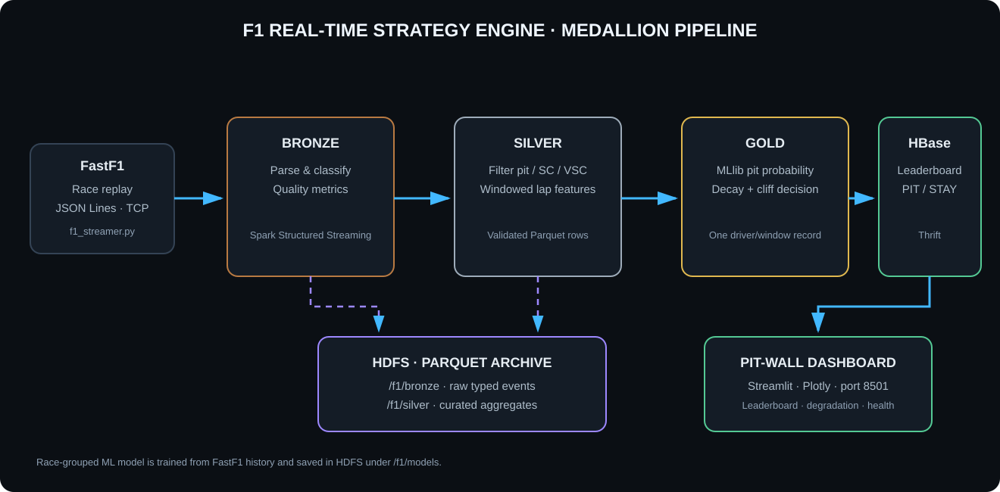

# F1 Real-Time Strategy Engine

FastF1 race telemetry flows through a Spark Structured Streaming medallion
pipeline into HDFS and HBase. A pit-wall dashboard presents live race position,
tyre degradation, and interpretable pit decisions.

## Objectives

- Replay Formula 1 race laps as timestamped JSON telemetry.
- Validate and aggregate laps with Spark while archiving raw and curated data
  to HDFS.
- Combine tyre-decay regression and a race-grouped MLlib pit-window classifier
  to produce per-driver `PIT` / `STAY` decisions.
- Persist race state and strategy signals in HBase for live dashboard queries.
- Measure trigger quality and replay throughput against actual FastF1 pit-in
  laps.

## Medallion architecture



### Bronze — ingest and archive

[`f1_streamer.py`](f1_streamer.py) replays FastF1 race laps over a TCP socket as
JSON lines. Spark parses and classifies the input, records data-quality
statistics, and appends typed raw events to HDFS at `/f1/bronze`.

### Silver — validate, filter, and aggregate

[`spark_scripts/silver.py`](spark_scripts/silver.py) validates required fields,
filters pit in/out laps, safety-car/VSC periods, and lap-time outliers, then
aggregates telemetry by driver, stint, and lap in a **5-second event-time
window sliding every 1 second**, with a **10-second watermark**. Lap times
outside **40–180 seconds** are filtered. Curated results are archived as
Parquet at `/f1/silver`.

### Gold — predict and serve

[`spark_scripts/gold.py`](spark_scripts/gold.py) combines regression-based
degradation and tyre-cliff signals with pit probabilities from a
race-grouped Spark MLlib model. [`spark_scripts/hbase_sink.py`](spark_scripts/hbase_sink.py)
upserts one decision per driver/window to HBase. The
[`dashboard/`](dashboard/) Streamlit app polls HBase for a live leaderboard,
degradation curves, strategy tiles, pipeline health, and race progress.
The configured decision thresholds are **0.20 seconds/lap** for decay and
**0.50** for pit probability (`spark_scripts/config.py`).
Spark SQL shuffle partitions default to **4** for the single-worker Compose
stack; override with `SPARK_SQL_SHUFFLE_PARTITIONS` for larger clusters.

## Tech stack

| Area | Technologies |
| --- | --- |
| Telemetry and replay | Python, FastF1, TCP/JSON Lines |
| Stream processing | Apache Spark Structured Streaming, PySpark |
| Machine learning | Spark MLlib, Logistic Regression, Decision Tree, Linear Regression |
| Data lake | Hadoop HDFS, Parquet |
| Serving store | Apache HBase, HappyBase / Thrift |
| Dashboard and charts | Streamlit, Plotly |
| Testing and lint | pytest, Ruff |
| Deployment | Docker, Docker Compose, Make |

## Module list

| Module | Purpose |
| --- | --- |
| [`f1_streamer.py`](f1_streamer.py) | Load FastF1 laps and replay telemetry to the Spark socket consumer; supports JSONL dry runs. |
| [`spark_scripts/f1_strategy_gold.py`](spark_scripts/f1_strategy_gold.py) | Start Bronze/Silver streaming, HDFS archives, quality and health metrics, and Gold processing. |
| [`spark_scripts/silver.py`](spark_scripts/silver.py) | Parse, classify, filter, and window-aggregate telemetry. |
| [`spark_scripts/gold.py`](spark_scripts/gold.py) | Run pit-model inference, degradation regression, cliff detection, and final decisions. |
| [`spark_scripts/strategy_rules.py`](spark_scripts/strategy_rules.py) | Pure PIT/STAY decision rule shared by Gold and unit tests. |
| [`spark_scripts/train_pit_model.py`](spark_scripts/train_pit_model.py) | Train and evaluate race-grouped pit-window classifier candidates; save the best model to HDFS. |
| [`spark_scripts/hbase_sink.py`](spark_scripts/hbase_sink.py) | Batch and retry HBase writes; expose dashboard history and health queries. |
| [`dashboard/app.py`](dashboard/app.py) | Render the auto-refreshing dark pit-wall dashboard. |
| [`evaluate.py`](evaluate.py) | Replay a race, compare triggers to real pit stops, sweep thresholds, and benchmark throughput/latency. |
| [`spark_scripts/verify_hbase.py`](spark_scripts/verify_hbase.py) | Scan HBase and print stored Gold records for verification. |
| [`docker/init/init.py`](docker/init/init.py) | Initialize required HDFS directories and HBase table families. |
| [`tests/`](tests/) | Cover streamer dry-run payloads, Silver filters, and the PIT/STAY decision rule. |

## Quick start

Prerequisites: Docker Compose, GNU Make, Python 3.11, and network access for
FastF1 data. The replay defaults to **2024 Bahrain**; the dashboard defaults to
**57 laps** (`F1_RACE_TOTAL_LAPS`, adjustable in the sidebar). The classifier
trainer defaults to Bahrain, Saudi Arabia, and Australia for **2023–2024**, with
**2024 Australia** held out. Start the infrastructure and initialize HDFS/HBase:

```bash
make up
make init
```

Train the model before starting Gold inference (optional for regression-only
fallback):

```bash
make train-model
```

Run the streamer target first in a terminal. It loads FastF1 data, listens for
the Spark socket client, and stays in the foreground for the duration of the
replay:

```bash
make stream
```

```bash
# Second terminal
make submit
```

In a third terminal, start the dashboard at
[http://localhost:8501](http://localhost:8501) and verify HBase rows:

```bash
make dashboard
make verify-hbase
```

Replay speed defaults to **60x** in Compose (about 2 minutes for the race); set
`F1_REPLAY_SPEED=1` for real time. `make reset` removes all containers and
volumes (HDFS archives, checkpoints) for a clean re-run; do this before
re-submitting the job, otherwise Silver history from earlier runs is reused.
Without Make (e.g. Windows PowerShell), run the same `docker compose --profile
tools ...` commands from the [Makefile](Makefile).

`make submit` is a foreground streaming process and remains active until
stopped; run it in a second terminal while `make stream` is listening. Run the
dashboard and verification targets from another terminal after the replay has
started.

To run checks locally:

```bash
pip install -r requirements.txt -r requirements-dev.txt
ruff check .
pytest -q
```

## Results

Evaluation methodology and generated metrics are documented in
[`docs/evaluation.md`](docs/evaluation.md). The evaluation replays a selected
race at 1x, 5x, and 20x, then reports regression-only, classifier-only, and
combined pit-trigger precision, recall, mean lead time, a 0.1–0.4 second
regression-margin sweep, records per second, and p50/p95 end-to-end latency.
The held-out training metrics are in [`docs/model_report.md`](docs/model_report.md).
Numeric pipeline defaults are centralized in
[`spark_scripts/config.py`](spark_scripts/config.py); the dashboard race-distance
default is 57 laps for the default Bahrain replay and can be changed in the UI.

Run an evaluation using the Makefile; start `make submit` in a second terminal
when the replay command asks Spark to connect:

```bash
make evaluate EVAL_SPEED=1
make evaluate EVAL_SPEED=5
make evaluate EVAL_SPEED=20
```

## Future scope

- **Kafka:** Replace the replay socket with durable Kafka topics and support
  consumer offsets and replayable event streams.
- **Multi-season runs:** Add season/race orchestration, broader
  race-grouped validation, and season-aware model reporting.
- **Webhook alerts:** Deliver configurable PIT triggers to team dashboards or
  messaging systems with rate limiting and delivery tracking.
- **AWS EMR:** Deploy Spark workloads and HDFS-compatible archives on managed
  EMR infrastructure, with cloud storage and scalable cluster sizing.
